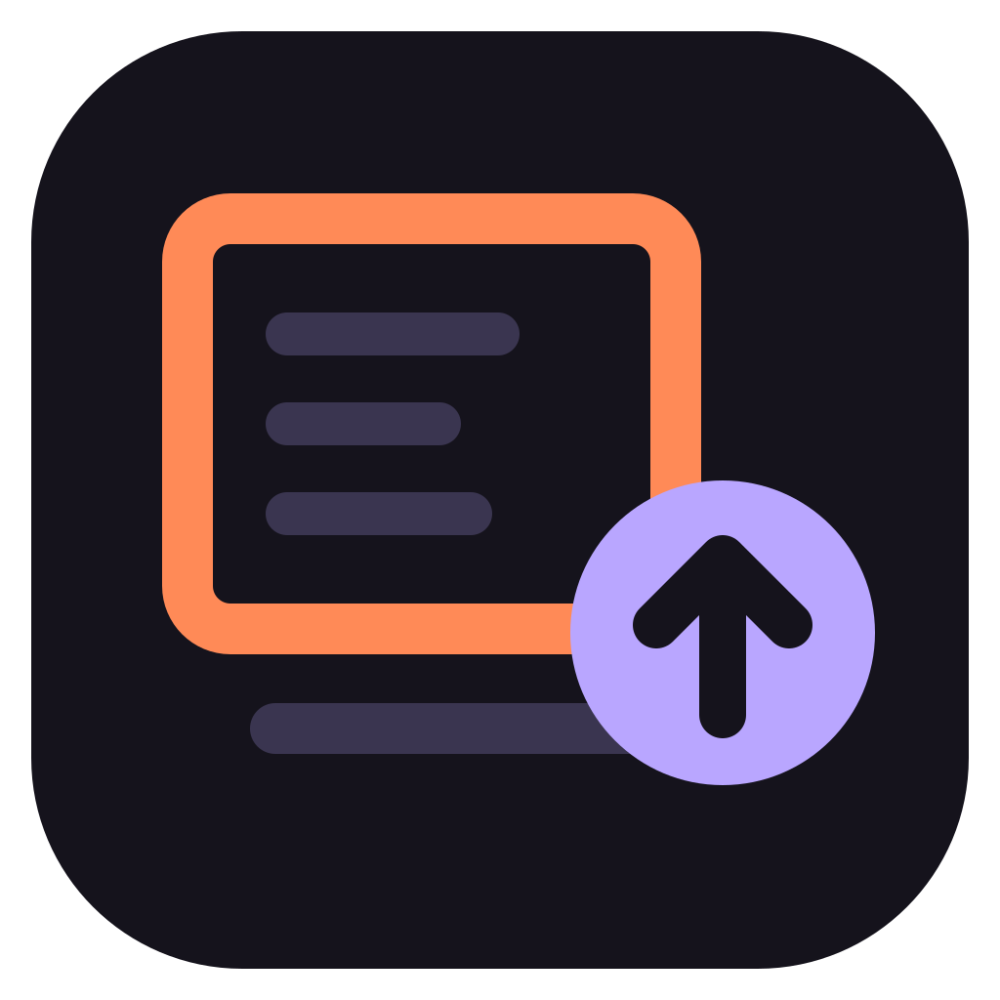

# Uptick

**Lists the updates for Claude Code, its plugins and your tools, and runs one only after you confirm the command.**


6 kinds checked, 5 updated, plus your own checks · 6 settings · 1 Python checker, standard library only · no telemetry of its own.

## Install

At the prompt of a terminal session:

```
/plugin install uptick --marketplace lumi-collective/uptick
```

Or from a shell, with settings if you want them:

```
claude plugin install uptick --marketplace lumi-collective/uptick --config brewfile=~/Brewfile
```

In the desktop app: + next to the prompt box → Plugins → Add marketplace `lumi-collective/uptick` → Add plugin.

It needs Python 3.9 or newer (`python3`, or `py` on Windows). On macOS run `xcode-select --install`; on Windows run
`winget install -e --id Python.Python.3.13`, or use python.org with its py launcher. Each optional tool turns on one
check, and a check whose tool is missing is skipped: **npm** for Claude Code's latest version and skill updates;
**gh**, signed in, for skills and plugins kept in their own GitHub repo; **Homebrew**; **uv** 0.10.10 or newer;
**winget** on Windows; **osv-scanner** (`brew install osv-scanner`, on Windows
`winget install --exact --id Google.OSVScanner`) and Homebrew's `brew vulns` for the vulnerability scan.

## Using it

`/uptick` opens the pane with the last result and checks again in the background; its reply in the conversation is
one line. A new session also checks in the background, fetching metadata first, when no check has fetched for a day.
The result shows in the pane and the line above the prompt, not in the conversation.

Pick an item with `1`–`9`, or all with `a`. The confirm step shows each command as it will run (with more than six,
the first five and a count). Move to **Update** with Tab or the arrow keys, then press Enter, or click it; Update
has no hotkey, and `n` cancels. For one item, **Skip** (no hotkey either) holds that version back: it adds the
version to your [known-broken list](docs/reference.md#known-broken-list), and the item waits under Known issues until
a newer one comes. Delete its entry in that file to undo.

Other keys: `s` stop after the current item, `r` check now (fetches metadata first), `l` type `/reload-plugins`, `o`
and `b` a failed update's output and back, `q` close; `ctrl+x tab` gives the pane the keyboard. A line above the
prompt says when updates wait; **Hide** keeps it away until the list changes.

## What it checks

| Group | Compared against | Updated with |
|---|---|---|
| Claude Code | the npm registry's latest | nothing: it updates itself; shown under Info. With its auto-update off, the row says so, and names `claude update` when that can run |
| Plugins | the version the plugin's marketplace advertises (a plugin in its own GitHub repo: that repo's `plugin.json`) | `claude plugin update <id>` |
| Skills installed with the [skills CLI](https://www.npmjs.com/package/skills) | the skill's folder on GitHub (tree hash) | `npx --yes skills@1.7.4 update -g <id>` |
| Homebrew formulae and casks | `brew outdated`, optionally only what your Brewfile lists | `brew upgrade <id>` (`--cask` for a cask) |
| uv tools, once `uv` is in `kinds` | `uv tool list --outdated` | `uv tool upgrade <name>` |
| winget packages, on Windows, once `winget` is in `kinds` | `winget upgrade --disable-interactivity` | `winget upgrade --id <id> --exact --accept-package-agreements --disable-interactivity` |
| Your own checks | whatever your `checkCommand` prints | an item of a kind above, with a valid id: that kind's command; an `info` item: nothing, shown under Info |

With `vulns` in `kinds`, an update that replaces a vulnerable version says how many and how bad (`2 vulns (high)`):
see [the vulnerability scan](docs/reference.md#vulnerability-scan).

## Configure

In `/config`, or at install with `--config <key>=<value>`:

| Key | Default | What it does |
|---|---|---|
| `kinds` | `plugin,skill,brew` | the groups to check and update; add `uv`, `winget` and `vulns` here. A group left out is not checked. The daily check reads `UPTICK_KINDS` instead, the checker run by hand `--kinds` |
| `brewfile` | empty | list only the outdated packages this Brewfile names |
| `knownBroken` | `${XDG_CONFIG_HOME:-~/.config}/uptick/known-broken.json`, if it exists | [upstream versions to hold back](docs/reference.md#known-broken-list); **Skip** adds to it |
| `checkCommand` | empty | [your own check](docs/reference.md#your-own-checks), merged into the list |
| `hint` | `band` | `band`: a line above the prompt; `status`: an entry in the status line; `off` |
| `fetchOnOpen` | `false` | fetch metadata every time the pane opens (slow) |

## Check it works

```
claude -p "/uptick"
```

It prints a report that starts with `Uptick: all current` or `Uptick: <n> available`, and installs nothing.

## What runs on your machine

A check installs nothing. An update runs only from the confirm step, where **Update** has no hotkey and Cancel holds
the focus.

**What leaves your machine:**

- the npm registry: the latest Claude Code version (`npm view`);
- the GitHub API through `gh`: skill folders and plugin manifests;
- only when `uv` is in `kinds`: PyPI, or the package index you set for uv, through `uv tool list --outdated`: the name
  of every uv tool, on every check (also one installed from git, a URL or a folder, shown as `not compared`);
- only when `winget` is in `kinds`, on Windows: your winget sources, through `winget upgrade`, on every check. By
  default these are the winget community repository and the Microsoft Store (cdn.winget.microsoft.com and
  storeedgefd.dsx.mp.microsoft.com, as Microsoft's docs list them; not measured). Uptick has not checked what winget
  sends them: it may include the ids of your installed packages for the Store source. winget also sends its own
  telemetry to Microsoft unless you turn it off in winget's settings. Uptick accepts no source agreement for you;
- only when `vulns` is in `kinds`, once a day per target (an hour after a failed scan): api.osv.dev, through
  `brew vulns` and `osv-scanner`: the names and versions of your Homebrew formulae, global npm packages, Appium and
  plugin dependencies, and of the packages in the lockfiles of the repositories in `scan-repos.json`; `brew vulns` also
  downloads Homebrew's public advisory list from formulae.brew.sh and raw.githubusercontent.com;
- with **Check now**, `fetchOnOpen`, `uptick-check`, or at a session start when no check has fetched for a day (tried
  again at a later start if the network was down): `claude plugin marketplace update` per marketplace, `brew update`;
- whatever your `checkCommand` fetches, and, when you confirm an update, whatever that tool fetches.

Uptick itself sends no telemetry. Skill updates run with `DISABLE_TELEMETRY=1` and `DO_NOT_TRACK=1`, which turn off
the skills CLI's own.

<details>
<summary>Everything it runs, reads and passes on</summary>

**Runs to check, installing nothing:** the checker, `plugin/checker/check_updates.py`, with `python3` (on Windows,
`py -3`): when the pane opens, on Check now, after each run of confirmed updates and after a Skip, for
`claude -p "/uptick"`, and at a session start when the last check is more than a day old or no check has fetched for
a day. It asks `claude`, `npm`, `gh`, `brew`, with `uv` in `kinds`
`uv tool list --outdated --show-version-specifiers --color never` and, with `winget` in `kinds` on Windows,
`winget upgrade --disable-interactivity` for installed and latest versions, and runs your `checkCommand` if set.
With `vulns` in `kinds`, once a day per target (an hour after a failed scan), it runs
`brew vulns --json`, `npm ls -g --all --json` and `osv-scanner scan source` on the global npm tree and the lockfiles
it found, with an empty config so that a scanned folder's `osv-scanner.toml` cannot hide a finding. With Check now,
`fetchOnOpen`, or at a session start when no check has fetched for a day, it first runs
`claude plugin marketplace update` and `brew update`.

**Runs only after you confirm:** one fixed command per item, from the table above, as an argument list without a
shell, from your home folder, so a project's `node_modules/.bin` or `.npmrc` cannot stand in for `npx`. The one
exception: on Windows, `npx` (and `claude`, when npm installed it) is a `.cmd` file that only `cmd.exe` can start, so
both run as `cmd.exe /d /c …`, and the confirm step shows that; `winget` starts as it is. An item's id must match a strict pattern for its kind
(no leading dash, no spaces, no shell characters), or it is shown as a problem and never offered.

**Never runs:** an update you did not confirm, or anything from a project's settings. **Reload plugins** (`l`) only
types `/reload-plugins` into the prompt; you press Enter. The `/uptick` hook passes every other command on untouched.
A cask that needs an administrator password fails at once (`SUDO_ASKPASS=/usr/bin/false`); run it in a terminal.

**Reads:** its cache file, `${XDG_CACHE_HOME:-~/.cache}/uptick/last.json`; your plugins' and skills' metadata
(`claude plugin list`, `~/.claude/plugins/known_marketplaces.json`, each marketplace's folder,
`~/.agents/.skill-lock.json`); the list of your uv tools, with the version specifier or source of each (from `uv`);
the list of your winget packages with an upgrade (from `winget`);
the Brewfile, if you set one; the known-broken list, yours or the default one when it exists. With `vulns` in
`kinds`: its scan file `vulns.json`, `~/.claude/plugins/installed_plugins.json`, the lockfiles under each plugin
install, `~/.appium/package-lock.json`, `scan-repos.json` and the lockfiles of the repositories it lists
(`node_modules` and `.git` left out). The environment variables `HOME`, `USERPROFILE`, `OS`, `XDG_CACHE_HOME` and
`XDG_CONFIG_HOME` to find those files, and `PATH` to find the programs. To tell whether Claude Code updates itself:
`DISABLE_UPDATES`, `DISABLE_AUTOUPDATER` and `CLAUDE_CODE_DISABLE_NONESSENTIAL_TRAFFIC`, from the environment and
from the `env` block of `~/.claude/settings.json`; nothing else in that file.

**Writes:** its cache file, and with `vulns` in `kinds` its scan file, `${XDG_CACHE_HOME:-~/.cache}/uptick/vulns.json`;
for a scan, an empty osv-scanner config and a list of the global npm packages, in a temporary folder it removes
afterwards. In Claude Code's store for the plugin: when a check last fetched, when a session start last tried one, and
what **Hide** hid. Only when you press Skip: your known-broken list (the `knownBroken` setting, else
`${XDG_CONFIG_HOME:-~/.config}/uptick/known-broken.json`). Skip adds that item's entry, or replaces one it wrote
before, and keeps the others. It leaves alone a list it cannot read and an entry you wrote for the item.

**Passes on:** each item's name (a winget package's id) to its update command; your marketplace names to `claude plugin marketplace update`;
the GitHub repositories, folders and refs named in your plugin and skill metadata to `gh api`, which asks GitHub for
them; the Brewfile path, the known-broken path and your `checkCommand` to the checker.

**The daily check, `uptick-check`,** runs `${XDG_CONFIG_HOME:-~/.config}/uptick/check.env` as shell code when it
exists, to set `UPTICK_BREWFILE`, `UPTICK_KNOWN_BROKEN`, `UPTICK_CHECK_COMMAND`, `UPTICK_KINDS` and `UPTICK_PATH` (see
[extras/README.md](extras/README.md)). It puts `UPTICK_PATH`, or by default `~/.local/bin` and the usual Homebrew
folders, before `PATH`, runs the checker with `--fetch` unless you pass `--no-fetch`, and on Linux sends a
`notify-send` notification when something needs a look, unless you pass `--no-notify`. On macOS it sends none.

</details>

## Platforms

| | Status |
|---|---|
| macOS, terminal | used daily |
| Windows, terminal | tried with Uptick 0.2.0 in a non-admin session: the pane, the confirm step, one skill update (its hash changed in the lock file), `claude -p "/uptick"`, and the vulnerability scan with osv-scanner 2.7.0 from winget worked. So did Update all, with 17 skills and one plugin. No Homebrew |
| Linux | the tests pass in CI; not tried in a session. No casks |
| Desktop app | the pane and the line above the prompt draw, but `/uptick` does not run there; a new session checks on its own when no check has fetched for a day, and the line's **Show** opens the pane |
| VS Code extension | untested |
| claude.ai (web, mobile) and Cowork | not supported: the plugin does not install there |

Tested with Claude Code 2.1.319. CI runs 8 jobs: the checker on Linux, macOS and Windows with Python 3.9 and 3.13,
and the plugin's validate and tests on Linux and Windows.

## Limits

- No other package managers (scoop, choco, apt, pacman, nix, pip); add one with `checkCommand`.
- winget packages are not tried on a Windows PC yet; the tests run on synthetic tables. A package whose id winget
  cuts short (it ends in `…`) is shown as `not compared`, never offered. A package whose installed version winget cannot
  tell is left out: the check does not pass `--include-unknown`. A package whose publisher asks winget to
  update it only by name (winget's explicit-targeting table) is shown as `not compared`, never offered; packages
  you pinned with `winget pin add` are left out, as winget leaves them out. A header of more than one word (Korean, for one)
  cannot be split into columns: the check then shows a problem row. A source whose agreement you have not
  accepted in winget fails the update with winget's message.
- Pinned Homebrew packages are left out. A plugin without a real version, or a uv tool from git, a URL, a folder or
  an exact pin, is shown as `not compared`, never offered.
- Plugins are listed as seen from your home folder: one installed only in another project's scope is not listed,
  unless your user settings turn it on.
- The vulnerability scan skips casks. A finding in global npm or Appium is counted, never a row: Uptick does not
  update those.
- An update shows a timer, not its live output.

All limits, with the reasons, and [troubleshooting](docs/reference.md#troubleshooting):
[docs/reference.md](docs/reference.md#limits-and-not-supported).

## Update and uninstall

```
claude plugin update uptick@uptick
claude plugin uninstall uptick@uptick
```

Run `/reload-plugins` after an update. Uninstalling leaves
[the files Uptick keeps](docs/reference.md#files-uptick-keeps).

## Contributing

Issues and pull requests are welcome. Read [AGENTS.md](AGENTS.md) and
[how to change it](docs/reference.md#customize-it-with-claude) first, and keep each change small and tested. Report a
vulnerability privately: [SECURITY.md](SECURITY.md). Changes: [CHANGELOG.md](CHANGELOG.md).

## License

[MIT](LICENSE)
